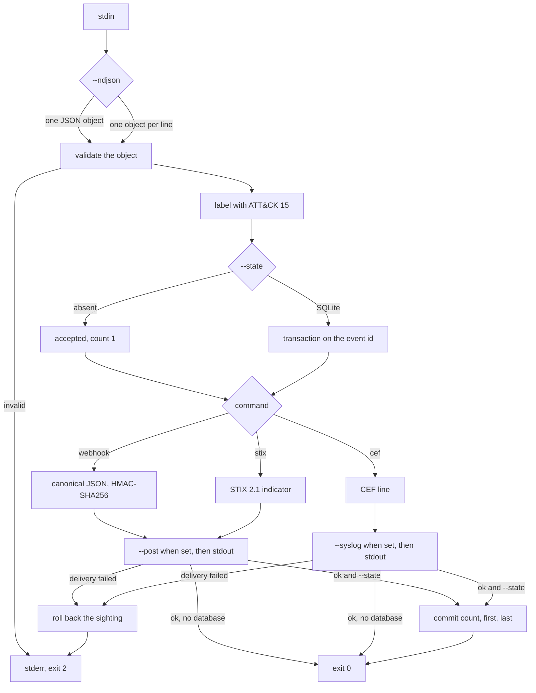

decoyevent reads decoy interactions from stdin and writes a signed JSON body, a CEF line, or a STIX 2.1 indicator. One invocation reads a single JSON object, or with `--ndjson` one object per line.

## Pipeline



When `--state` is set, the SQLite transaction stays open until the optional delivery and the stdout write both succeed. `--post` is for `webhook` and `stix`. `--syslog` is for `cef`. With `--ndjson`, a failed line is reported and later lines still run; the process exits 2 after the stream ends.

## Install

```text
go install github.com/doganaydin/decoyevent/cmd/decoyevent@latest
```

From this repository, `go run ./cmd/decoyevent` does the same job.

## Usage

Without `--ndjson`, stdin is one JSON object and a second object is rejected. With `--ndjson`, each line is one object.

The signature function is tested against these exact bytes and the key `lab-secret`. The body has no trailing newline. The signature is `a2abe963152952a171b5acd0c8bbdadc18711484b10ef534ce97b467c4330b1b`.

```json
{"id":"lab-ssh-1","time":"2026-11-02T16:00:00Z","src_ip":"203.0.113.10","dst_port":22,"protocol":"ssh","action":"login"}
```

A full event also receives an ATT&CK label, a severity, and a dedup status. Those fields are part of the body that is signed. `testdata/login.json` produces `testdata/login.webhook.json`, and with `DECOYEVENT_SECRET=lab-secret` the stderr line is:

```text
X-Decoyevent-Signature: sha256=3c32bfd33dd55a181c5f114b78936735d3397659aa96504addba75a086d54187
```

```text
export DECOYEVENT_SECRET=lab-secret
decoyevent webhook --post https://collector.example/hooks/decoy < testdata/login.json
decoyevent cef --syslog udp://10.0.0.5:514 < testdata/login.json
decoyevent stix --post https://collector.example/indicators < testdata/login.json
```

The body is still written to stdout. `--post` and `--syslog` deliver the same bytes to another system. `--post` requires `DECOYEVENT_SECRET` and sends `X-Decoyevent-Signature`. A redirect is treated as a failure. `--syslog` takes `udp://host:port` or `tcp://host:port` and wraps the CEF line in an RFC 3164 message, facility `local0`. Syslog has no signature header. `--syslog` is only valid with `cef`.

`--ndjson` reads stdin until it ends and treats each line as one JSON object. Empty lines are skipped. A line that fails validation or delivery is written to stderr as `line N: …`, and the following lines are still delivered. The process exits 2 when any line failed or the scanner reports an error. Webhook lines gain a trailing newline on stdout so the stream stays one object per line. The signature covers the object without that newline.

```text
decoyevent cef --ndjson --state /tmp/decoyevent.db --syslog udp://10.0.0.5:514 < olaylar.ndjson
```

Count repeats in a SQLite database. The second run of the same id prints `cnt=2` and `outcome=duplicate`.

```text
decoyevent cef --state /tmp/decoyevent.db < testdata/login.json
```

The database is created with mode `0600`. A write lock is held until the delivery finishes. If syslog or the webhook returns an error, the counter is not saved.

## CEF

```text
CEF:0|Decoyevent|decoyevent|1.0|T1110|ssh login|8|src=203.0.113.10 dst=192.0.2.5 dpt=22 proto=ssh act=login dvchost=lab-1 cs1Label=decoy cs1=bastion cs2Label=eventId cs2=lab-ssh-1 cs3Label=attack cs3=15 cnt=1 outcome=accepted
```

`|` and `\` in the header are escaped. `=`, `\`, and newlines in extension values are escaped. An unmapped action uses the signature `UNMAPPED`.

## Fields

| Field | Required | Rule |
|---|---|---|
| `id` | yes | 1–128 characters, `[A-Za-z0-9._:-]` |
| `time` | yes | RFC3339, written back in UTC |
| `src_ip` | yes | IPv4 or IPv6, no zone identifier |
| `dst_port` | yes | integer 1–65535 |
| `protocol` | yes | 1–32 characters, `[a-z0-9._-]` |
| `action` | yes | same syntax as `protocol` |
| `dst_ip` | no | same syntax as `src_ip` |
| `sensor` | no | 1–64 characters, `[A-Za-z0-9._:-]` |
| `decoy` | no | same syntax as `sensor` |
| `message` | no | 0–256 characters, no control characters |

A field outside this list is rejected. The keys `password`, `pass`, `passwd`, `secret`, `token`, `authorization`, `cookie`, and `set-cookie` are rejected anywhere in the document, in any letter case. Nested objects and arrays are rejected. Bodies larger than 1 MiB are rejected.

## ATT&CK

The table is ATT&CK 15 and only the rows below. An unknown pair is left unlabeled. It is not mapped to a nearby technique. `attack_version` is the string `15`.

| Protocol | Action | Technique |
|---|---|---|
| tcp | scan | T1046 |
| ssh | login | T1110 |
| ftp | login | T1110 |
| mysql | login | T1110 |
| rdp | login | T1021.001 |
| ssh | session | T1021.004 |
| http | request | T1071.001 |
| http | login | T1078 |
| token | use | T1078 |
| token | file | T1005 |

| Technique | CEF severity | STIX confidence |
|---|---|---|
| none | 3 | 40 |
| T1046, T1071.001 | 5 | 60 |
| T1110, T1021.001, T1021.004 | 8 | 75 |
| T1078, T1005 | 9 | 90 |

STIX output is one `indicator` object. The indicator id is a UUID version 5 of `decoyevent|` plus the event id, under the namespace `a3b0c1d2-e3f4-4516-87a9-b0c1d2e3f405`. That namespace is a project constant, not an IANA registration. The same event id always yields the same indicator id.

## Dedup

The dedup key is the event `id`. The source address is not a key. The window is 24 hours, measured from when decoyevent processes the event, not from the event timestamp. The first sighting is `accepted` with count 1. A repeat inside the window is `duplicate`, the count increases, and `first` stays at the original processing time. After the window, the id is accepted again at count 1.

Without `--state`, the process does not remember ids and stderr includes `dedup disabled`. The output still says `accepted` and `cnt=1`, because there is no earlier copy to merge with. With `--state`, the counter lives in a SQLite table named `sightings`. The columns are `id`, `count`, `first`, and `last`. Rows older than 24 hours are deleted on the next event. Two processes can open the same database; the write lock makes the increment atomic.

## Threat model

decoyevent formats an event produced by a decoy its operator already runs. It is not a network service, and it should not be exposed as one. The input is still validated: a credential field is rejected so a password cannot ride along into a SIEM. The HMAC covers the exact body bytes, whether they are written to stdout or posted. A proxy that reformats the JSON breaks the signature, which is the point. The syslog path cannot carry that header, so a SIEM that needs authenticity should use `--post`.

## Out of scope

decoyevent does not listen on a port, emulate a protocol, ship a TAXII server, score an address, or block anything. Those belong in the sensor and in the control that receives the CEF line or the webhook.
